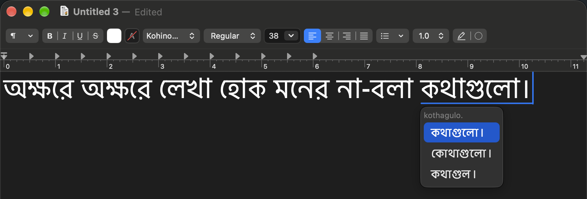
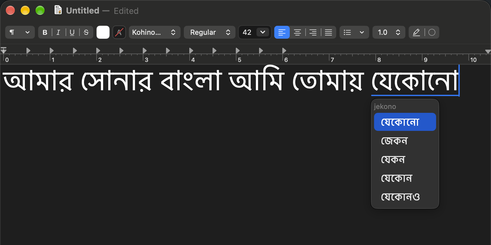
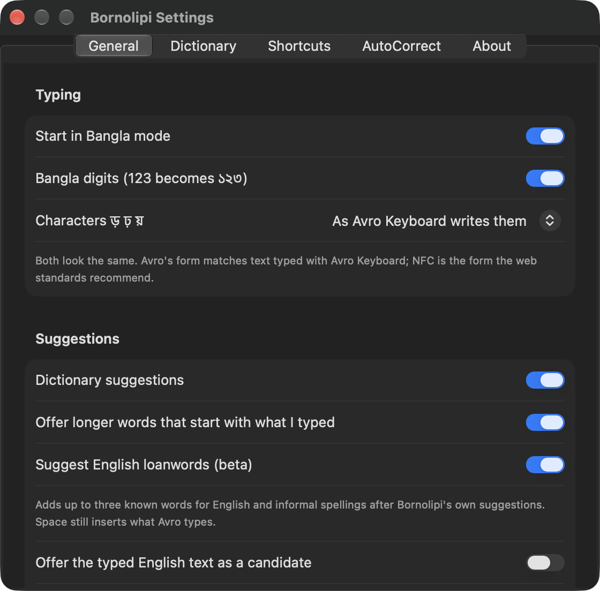
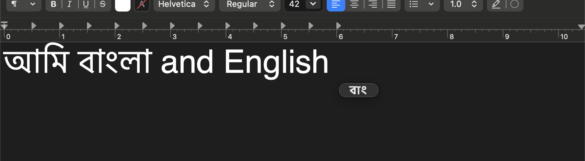

# Bornolipi

**Type Bangla. Naturally.**

Bornolipi is a free, open-source phonetic Bangla keyboard for macOS, compatible with Avro Phonetic and
built natively on InputMethodKit. Type `ami banglay gan gai`, get `আমি বাংলায় গান গাই`, in any app.
It suggests the word you meant when you type informally (`bari` offers বাড়ি, `sarkar` offers
সরকার), while Space always types what Avro would. Optionally, it also suggests known words for
English spellings (`computer` offers কম্পিউটার), after its own suggestions.

**Status: 0.1.0-beta.1, limited public beta.** Universal app (Apple silicon and Intel) built for
macOS 13 or later, but tested only on macOS 27 on Apple silicon. It has **not been tried on an Intel
Mac or on macOS 13–26**.

## Screenshots

  
   অক্ষরে অক্ষরে লেখা হোক মনের না-বলা কথাগুলো। Typed phonetically (<code>okkhore okkhore lekha hOk moner na-bola kothagulo.</code>) in TextEdit, with Bornolipi's suggestions for the last word.

<table>
  <tr>
    <td width="50%"></td>
    <td width="50%"></td>
  </tr>
  <tr>
    <td>Informal spellings: <code>jekono</code> offers যেকোনো. Pick with ↑ ↓ or a click.</td>
    <td>Settings: typing, suggestions, and the optional English loanwords beta.</td>
  </tr>
  <tr>
    <td colspan="2" align="center"></td>
  </tr>
  <tr>
    <td colspan="2" align="center">Control-Shift-B switches between Bangla and English; a small বাং/EN bubble shows the mode.</td>
  </tr>
</table>

## Install

1. Download **Bornolipi-0.1.0-beta.1.dmg** from the [Releases page](https://github.com/meheduz/Bornolipi/releases)
   and compare its SHA-256 with the release's `SHA256SUMS`. Open the image and drag **Bornolipi** onto
   **Applications**.
2. **Allow it to open (first time only).** Bornolipi is free and not notarized by Apple, so macOS warns
   you. Close the message (do not move it to the Trash), open **System Settings > Privacy & Security**,
   scroll to **Security**, click **Open Anyway** and confirm. The button appears for about an hour after
   macOS blocks the app; if it is missing, open Bornolipi again. Never turn Gatekeeper off.
3. **Follow the setup assistant.** It installs the keyboard for your user only (no administrator
   password). macOS then requires you to turn it on yourself, once: **System Settings > Keyboard >
   Input Sources > Edit… > + > Bangla > Bornolipi > Add**. The assistant notices when you are done.
4. **Type.** Choose **Bornolipi** (ব) from the input menu in the menu bar, or press Control-Space.

| Key | What it does |
| --- | --- |
| Space | Finishes the word |
| ↑ ↓, or a click | Picks another suggestion |
| Return | Finishes the word, then starts a new line (or sends, in chat apps) |
| Esc | Keeps the English letters you typed |
| Control-Shift-B | Switches between Bangla and English; a small বাং/EN bubble shows the mode |

Your own words, shortcuts and options are under **Bornolipi > Settings…** in the input menu, or
**Keyboard Settings…** in the Bornolipi app.

**Updating.** Bornolipi checks GitHub for a newer stable version at most once a day (you can turn this
off) and never downloads anything by itself. Download the new image, drag Bornolipi onto Applications
and choose **Replace**, approve it with **Open Anyway** again, then click **Update Now** in the app.
Your words, learned choices and settings are kept. Apps that were open during the update may need to
be reopened.

**Uninstalling.** In the Bornolipi app, click **Uninstall…** and choose whether to delete your data
too. If Bornolipi is still listed under Input Sources, select it there and click **−**. Your data lives
in `~/Library/Application Support/Bornolipi`, `~/Library/Preferences/io.github.meheduz.inputmethod.Bornolipi.plist`
and `~/Library/Preferences/io.github.meheduz.Bornolipi.plist`.

Problems: [docs/TROUBLESHOOTING.md](docs/TROUBLESHOOTING.md).

## Beta feedback

Please file a short [installation report](https://github.com/meheduz/Bornolipi/issues/new?template=install-report.yml)
with your macOS version, whether installation worked, and whether Bornolipi appeared under Bangla in
Input Sources. Reports from Macs where everything worked are just as useful. For other problems, use
**Report a Problem** in the app; its diagnostic report never contains anything you typed.

## Known limitations

- **Bornolipi may be missing from the Input Sources list.** On some Macs, System Settings shows an old
  list of keyboards that does not include ones installed later, so Bornolipi cannot be added there
  even though it is installed and registered correctly. No supported fix is known; please report it.
- Not signed with a Developer ID and not notarized: the first launch and each update need **Open Anyway**.
- Updates are a manual download; Bornolipi only checks for them.
- Avro compatibility is kept even where Avro's own data is wrong: `chittagong` and `brahmanbaria`
  autocorrect to চট্রগ্রাম and ব্রাহ্মনবাড়িয়া (the standard spellings are offered next), and an
  explicit `:` (visarga) is dropped when a dictionary word without it matches (`shoto:` gives শত).
- The menu bar icon stays ব in English mode; the বাং/EN bubble shows the mode.
- After an update, apps that were open (seen with Chrome and Terminal) may need to be reopened.

## Privacy

- The keyboard (`BornolipiKeyboard.app`) never connects to the internet. What you type, your personal
  words and learned choices stay on your Mac.
- The Bornolipi app connects only to GitHub, to check for a newer version. It sends no personal data.
- Password fields always receive plain letters: macOS turns keyboards like Bornolipi off there.

## Develop

| Command | Purpose |
| --- | --- |
| `scripts/test.sh [suite]` | all automated checks (what CI runs), or one suite: engine, installer, eval, fuzz, security, lint, bench, release |
| `swift test` | unit, property and installer tests |
| `scripts/lint.sh` | swift-format rules, warnings as errors |
| `scripts/build.sh` | builds `build/Bornolipi.app` (setup app with the keyboard inside) |
| `scripts/make-dmg.sh` | universal disk image; its window layout needs `dmgbuild` (`python3 -m venv build/.venv && build/.venv/bin/pip install dmgbuild==1.6.5`) |
| `scripts/check-release.sh <dmg>` | validates an image: contents, identities, versions, universal binaries, signatures |
| `echo bhalobasha \| swift run bangla-convert` | candidates for a word (`--raw`: rules only) |
| `swift run -c release bangla-bench` | latency, load time, memory |
| `BORNOLIPI_ALLOW_INSTALL=1 scripts/dev-install.sh && scripts/e2e-test.sh` | installs your build over the installed keyboard, then types through macOS |
| `scripts/ui-preview.sh`, `scripts/setup-preview.sh` | screenshots of every window, light and dark |

Automated tests use temporary directories only and never touch the installed keyboard or personal
data. Diagnostics (never typed text):
`log stream --level debug --predicate 'subsystem == "io.github.meheduz.inputmethod.Bornolipi"'`.

**Releasing.** Raise `BUILD_NUMBER` above every build anyone may have installed (the app replaces the
installed keyboard only when its own is newer), set `VERSION` (numeric) and `RELEASE_LABEL` (public
name), add a `CHANGELOG.md` section, run `scripts/test.sh`, build with `scripts/make-dmg.sh`, and check
it with `scripts/check-release.sh`. Upload that tested image and `SHA256SUMS` by hand; mark betas as
pre-releases. Keep the repository name `Bornolipi`: the update check reads its latest release.

See [CONTRIBUTING.md](CONTRIBUTING.md) and [SECURITY.md](SECURITY.md).

## License

MPL-2.0. See [NOTICE.md](NOTICE.md) for the data sources.
